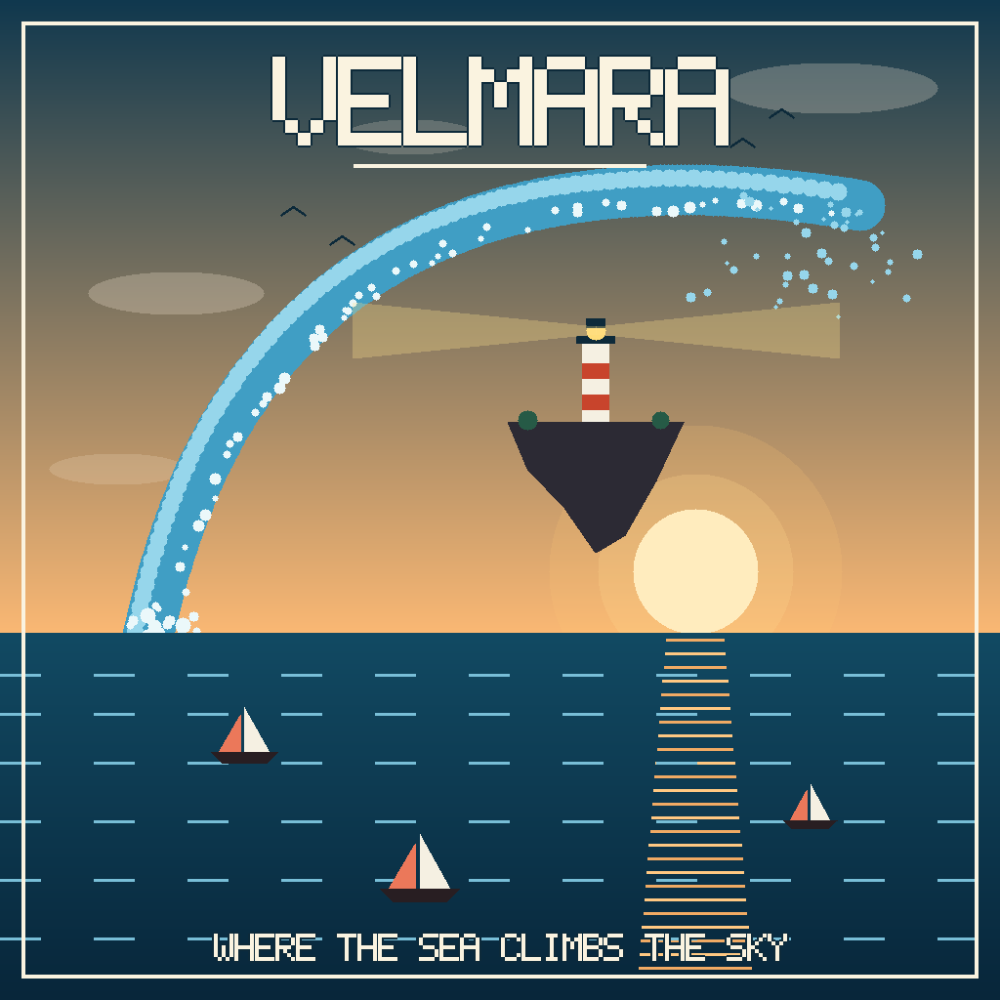

# Velmara — The Poster for a Place That Isn't There

[](https://make.fun/bounty/the-poster-for-a-place-that-i-2-20261121-0539)
[](https://make.fun/bounty/the-poster-for-a-place-that-i-2-20261121-0539)
[](https://make.fun/bounty/the-poster-for-a-place-that-i-2-20261121-0539)

A travel poster for **Velmara**, an isle where the sea climbs the sky: a
great arc of water rises out of the ocean and pours upward into the
sunset, past a lighthouse that stands on a floating rock. Sailboats
cross the water below, and the sun lays a glittering path across the
waves. The promise of a stay in Velmara is simple — come and watch the
tide go up.



## The place

Velmara is an island in a sea that never learned to stay down. Each
evening the tide lifts off the water in one slow arc and climbs toward
the stars, and the lighthouse on the floating rock keeps its beam on
the rising water so the night boats can find their way home. Visitors
come for the sunset, stay for the climb, and leave with salt in their
hair and their sense of up and down pleasantly rearranged.

## How it is made

`main.py` (Python 3.13, standard library only) draws the poster pixel
by pixel — sky gradient, sun, clouds, the rising arc of water, the
floating lighthouse rock, the sea with its sailboats — and encodes the
result as a PNG with a hand-built encoder (`zlib` + `struct`). No
images are loaded, no network is used, and no randomness is involved:
two runs write byte-identical files.

```sh
MAKEFUN_OUTPUT_DIR=out python3 main.py   # writes out/entry.png
```

The output is a 1024×1024 PNG of 27,607 bytes, inside the competition's
gate (a whole PNG, at most 1,048,576 bytes and 1024 by 1024 pixels).

## Entry

This repository is an entry for the make.fun bounty
[The Poster for a Place That Isn't There](https://make.fun/bounty/the-poster-for-a-place-that-i-2-20261121-0539)
(`the-poster-for-a-place-that-i-2-20261121-0539`). The program is
`main.py`; the poster it draws is `entry.png`.

## License

MIT — see [LICENSE](LICENSE).
